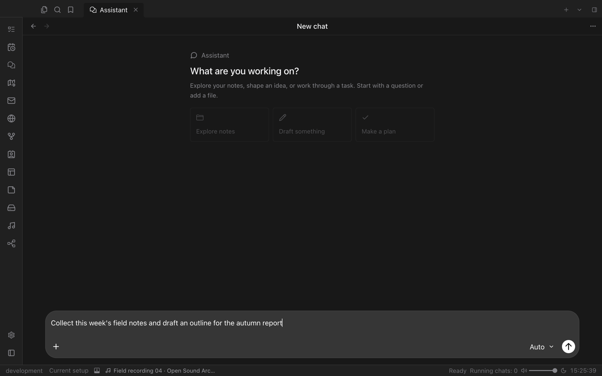
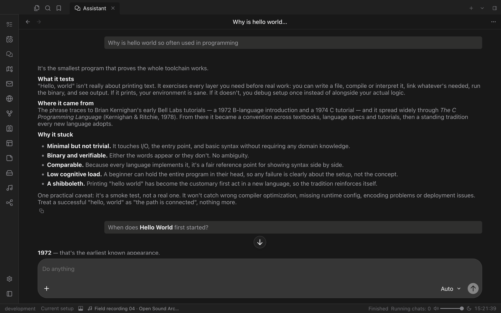

# Assistant

A chat assistant that works inside Valley. Ask questions, draft and edit with your notes as context, and let it open files, control plugins and carry out tasks for you.

## Chats that know your vault

Start a chat to explore your notes, shape an idea or work through a task. Assistant can read and edit files in your vault, open views and run the commands that Valley and your plugins provide, so "open my route in Map" or "create a note for today's meeting" just happens.

Answers render as rich Markdown. Every step Assistant takes is grouped in a collapsible timeline below its reply, with commands, file changes and their results, so you can always see what happened.

## Projects

A Project bundles working folders and shared instructions for a set of chats. Folders can live outside your vault, and Assistant edits the selected files directly. Deleting a chat or project never removes your project files.

## You stay in control

- Choose between **Vault only** and **Full access**.
- AI providers, models, usage and budgets are managed in Valley's AI settings, with your own credentials.
- Guards ask before sensitive actions, and denied actions stay denied.
